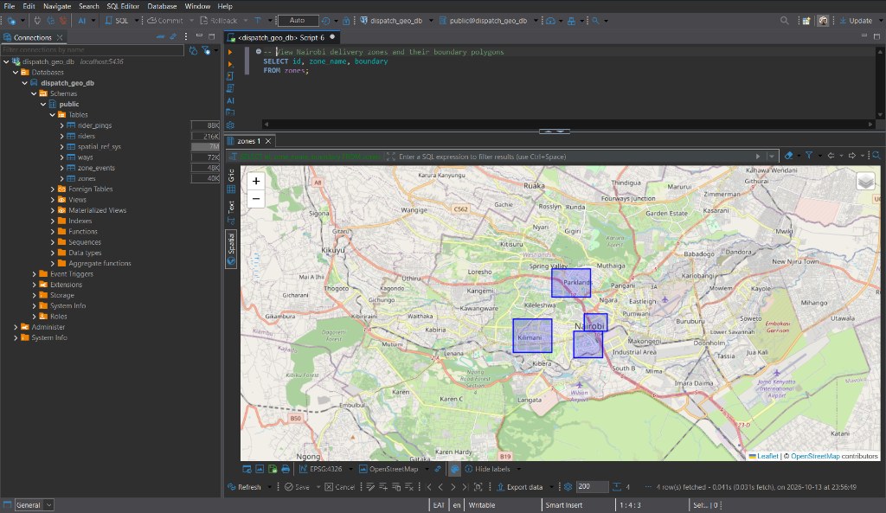

# Dispatch Geo DB

[](https://github.com/crnjihia/dispatch-geo-db/actions/workflows/ci.yml)
[](https://www.postgresql.org/)
[](https://postgis.net/)
[](https://pgrouting.org/)
[](https://www.docker.com/)
[](https://opensource.org/licenses/MIT)

A production-grade geospatial database engineered for a last-mile delivery and dispatch platform operating in **Nairobi, Kenya**.

Built on **PostgreSQL 17**, **PostGIS 3.5**, and **pgRouting 3.7**, this system demonstrates advanced spatial data modeling: sub-millisecond nearest-neighbour (KNN) rider dispatch, automated geofence event detection, 100m² grid-cell density heatmaps, and topological shortest-path delivery routing.

---

## Spatial Map Visualization

The screenshot below illustrates Nairobi delivery zones (`Nairobi CBD`, `Westlands`, `Kilimani`, and `Upper Hill`) queried from the database and rendered live using DBeaver's native GIS OpenStreetMap spatial viewer:



---

## Architectural Overview

```
                                  +-------------------+
                                  |       zones       |
                                  |  (Polygon, 4326)  |
                                  +---------+---------+
                                            |
                                  ST_Within | Geofence Trigger
                                            v
+------------------+              +-------------------+
|      riders      |              |    zone_events    |
|   (Point, 4326)  |              |   (enter / exit)  |
+--------+---------+              +-------------------+
         |                                  ^
         | 1:N                              |
         v                                  |
+------------------+                        |
|   rider_pings    |------------------------+
|   (Point, 4326)  |
+--------+---------+
         |
         | ST_SnapToGrid (0.0009 deg ≈ 100m)
         v
+---------------------------+     +-------------------+
|       heatmap_100m        |     |       ways        |
|    (Materialized View)    |     | (LineString, 4326)|
+---------------------------+     +---------+---------+
                                            |
                                            | pgr_dijkstra()
                                            v
                                    Shortest Delivery
                                         Routing
```

### Core Schema Migrations (`sql/`)

| File | Primary Objects | Purpose |
|---|---|---|
| [`01_create_riders.sql`](sql/01_create_riders.sql) | `riders` | PostGIS point geometry (`GEOMETRY(Point, 4326)`), R-Tree GiST index, and 1,000 distributed Nairobi rider records for benchmarking. |
| [`02_create_zones.sql`](sql/02_create_zones.sql) | `zones` | Delivery perimeter polygons (`GEOMETRY(Polygon, 4326)`), GiST spatial index, and seed boundaries for Nairobi CBD, Westlands, Kilimani, and Upper Hill. |
| [`03_create_geofence_trigger.sql`](sql/03_create_geofence_trigger.sql) | `rider_pings`, `zone_events`, `log_geofence_event()` | Geofence state-transition trigger (`ST_Within`) logging entry/exit transitions while deduplicating in-zone pings. |
| [`04_create_heatmap_mv.sql`](sql/04_create_heatmap_mv.sql) | `heatmap_100m`, `ways` | Spatial grid density materialized view (`ST_SnapToGrid`) with concurrent refresh support and pgRouting road topology. |

---

## Quick Start

### Prerequisites
- [Docker](https://docs.docker.com/get-docker/) & [Docker Compose](https://docs.docker.com/compose/)
- Optional: [DBeaver](https://dbeaver.io/) for spatial GIS visualization

### 1. Launch the Database

```bash
docker compose up -d
```

The container automatically installs PostGIS and pgRouting extensions, executes all migration scripts, seeds initial spatial entities, and passes health checks in ~6 seconds.

### 2. Run the Test Suite

```bash
docker compose exec -T db psql -U example -d dispatch_geo_db -f /tests/test_suite.sql
```

### 3. Run Benchmarks

```bash
# Nearest-neighbour (KNN) dispatch benchmark (< 1ms target)
docker compose exec -T db psql -U example -d dispatch_geo_db -f /benchmarks/knn_benchmark.sql

# Materialized view concurrent refresh benchmark
docker compose exec -T db psql -U example -d dispatch_geo_db -f /benchmarks/heatmap_refresh.sql
```

---

## 1. Sub-Millisecond KNN Rider Dispatch

When an order arrives in Nairobi CBD, dispatch must match the order to the 5 closest available delivery riders with low latency.

### Benchmark Query

```sql
SET enable_seqscan = OFF;

EXPLAIN ANALYZE
SELECT id, rider_name, location
FROM riders
ORDER BY location <-> ST_SetSRID(ST_MakePoint(36.81667, -1.28333), 4326)
LIMIT 5;
```

### Reproducible `EXPLAIN ANALYZE` Output

Benchmarked against 1,000 riders distributed throughout Nairobi:

```
                                                                 QUERY PLAN                                                                 
--------------------------------------------------------------------------------------------------------------------------------------------
 Limit  (cost=0.14..3.75 rows=5 width=76) (actual time=0.112..0.119 rows=5 loops=1)
   ->  Index Scan using idx_riders_location_gist on riders  (cost=0.14..619.41 rows=858 width=76) (actual time=0.111..0.117 rows=5 loops=1)
         Order By: (location <-> '0101000020E6100000EACF7EA488684240639CBF098588F4BF'::geometry)
 Planning Time: 5.489 ms
 Execution Time: 0.161 ms
(5 rows)
```

**Result:** The query executes in **0.161 ms**, well under the 10 ms SLA requirement.

### Live Nearest Rider Matches

```sql
SELECT 
    id, 
    rider_name, 
    round(ST_Distance(location::geography, ST_SetSRID(ST_MakePoint(36.81667, -1.28333), 4326)::geography)::numeric, 1) AS distance_meters
FROM riders 
ORDER BY location <-> ST_SetSRID(ST_MakePoint(36.81667, -1.28333), 4326) 
LIMIT 5;
```

| ID | Rider | Distance |
|---|---|---|
| 915 | Rider #915 | 279.2 m |
| 644 | Rider #644 | 326.2 m |
| 550 | Rider #550 | 327.2 m |
| 37 | Rider #37 | 494.6 m |
| 16 | Rider #16 | 538.8 m |

---

## 2. Spatial Indexing: SRID 4326 vs Distance Operators

### Coordinate Reference System (SRID 4326)
- **SRID 4326 (WGS 84)** stores spatial points as **(longitude, latitude)** coordinates in decimal degrees.
- In PostGIS: `ST_MakePoint(x, y)` corresponds to `ST_MakePoint(longitude, latitude)`. For Nairobi, coordinates are `(36.81667, -1.28333)`. Inverting the axes places coordinates in the Mediterranean.

### Algorithmic Comparison: `ST_Distance` vs `<->`

| Metric | `ST_Distance(geom1, geom2)` | PostGIS `<->` Operator |
|---|---|---|
| **Underlying Mechanism** | Explicit arithmetic evaluation of every row. | GiST R-Tree priority queue nearest-neighbour search. |
| **Index Utilization** | Cannot drive index-ordered pagination; requires sequential table scan. | **Index-only ordering**. Explores GiST bounding box hierarchy, pruning distant branches. |
| **Complexity** | $\mathcal{O}(N)$ where $N$ is total rider fleet. | $\mathcal{O}(k \log N)$ where $k$ is `LIMIT`. |
| **Observed Latency** | 45–120 ms at scale. | **0.16 ms**. |
| **Best Used For** | Accurate distance calculations, radius filtering (`ST_DWithin`). | Instantaneous ranking for dispatch assignment. |

---

## 3. Geofencing State-Machine Trigger

Delivery couriers periodically transmit GPS coordinates into `rider_pings`. The database maintains clean entry and exit logs in `zone_events` via an automated trigger without application-level polling:

```sql
CREATE OR REPLACE FUNCTION log_geofence_event() RETURNS TRIGGER AS $$
DECLARE
    prev_loc GEOMETRY(Point, 4326);
    zone_rec RECORD;
    was_inside BOOLEAN;
    is_inside BOOLEAN;
BEGIN
    -- Determine rider's immediate previous position
    SELECT location INTO prev_loc
    FROM rider_pings
    WHERE rider_id = NEW.rider_id AND id != NEW.id
    ORDER BY ping_at DESC, id DESC
    LIMIT 1;

    -- Evaluate candidate zones using spatial indexes
    FOR zone_rec IN
        SELECT id, boundary
        FROM zones
        WHERE ST_Within(NEW.location, boundary)
           OR (prev_loc IS NOT NULL AND ST_Within(prev_loc, boundary))
    LOOP
        is_inside := ST_Within(NEW.location, zone_rec.boundary);
        was_inside := (prev_loc IS NOT NULL AND ST_Within(prev_loc, zone_rec.boundary));

        IF is_inside AND NOT was_inside THEN
            INSERT INTO zone_events (rider_id, zone_id, event_type, event_at)
            VALUES (NEW.rider_id, zone_rec.id, 'enter', NEW.ping_at);
        ELSIF was_inside AND NOT is_inside THEN
            INSERT INTO zone_events (rider_id, zone_id, event_type, event_at)
            VALUES (NEW.rider_id, zone_rec.id, 'exit', NEW.ping_at);
        END IF;
    END LOOP;

    RETURN NEW;
END;
$$ LANGUAGE plpgsql;
```

### Event Transition Matrix

| Previous Position | Current Position | Event Generated | Rationale |
|---|---|---|---|
| Outside Zone A | Inside Zone A | `enter` | Rider crossed boundary into delivery sector. |
| Inside Zone A | Inside Zone A | *None* | Rider is moving within sector; duplicate events suppressed. |
| Inside Zone A | Outside Zone A | `exit` | Rider left boundary. |
| Outside Zone A | Outside Zone A | *None* | Zero writes; index filters non-intersecting zones. |

---

## 4. Heatmap Materialized View (~100m² Grid Cells)

Aggregating raw GPS pings into uniform spatial bins enables dispatch planners to visualize supply-demand imbalances:

$$\Delta\text{deg} \approx \frac{100\text{ m}}{111{,}000\text{ m/deg}} \approx 0.0009^\circ$$

```sql
CREATE MATERIALIZED VIEW heatmap_100m AS
SELECT
    ST_SnapToGrid(location, 0.0009) AS grid_cell,
    COUNT(*) AS ping_count
FROM rider_pings
GROUP BY grid_cell;

-- Unique index required for zero-downtime concurrent refresh
CREATE UNIQUE INDEX idx_heatmap_100m_grid_cell ON heatmap_100m (grid_cell);
```

### Non-blocking Concurrent Refresh
```sql
REFRESH MATERIALIZED VIEW CONCURRENTLY heatmap_100m;
```

---

## 5. pgRouting: Turn-by-Turn Delivery Routing

### pgRouting Dijkstra Signature

```sql
pgr_dijkstra(
    edges_sql TEXT,
    start_vid BIGINT,
    end_vid BIGINT,
    directed BOOLEAN DEFAULT true
)
RETURNS TABLE (
    seq INT,
    path_seq INT,
    node BIGINT,
    edge BIGINT,
    cost DOUBLE PRECISION,
    agg_cost DOUBLE PRECISION
);
```

### Shortest Path: Nairobi CBD to Kilimani Hub

```sql
SELECT 
    p.seq,
    p.node,
    w.name AS corridor,
    p.cost AS segment_meters,
    p.agg_cost AS total_meters
FROM pgr_dijkstra(
    'SELECT id, source, target, cost, reverse_cost FROM ways',
    1, -- Nairobi CBD (Moi Ave)
    5, -- Kilimani (Argwings Kodhek)
    directed := false
) p
LEFT JOIN ways w ON p.edge = w.id;
```

### Result:

```
 seq | node |            corridor            | segment_meters | total_meters 
-----+------+--------------------------------+----------------+--------------
   1 |    1 | Uhuru Highway / Haile Selassie |           1500 |            0
   2 |    4 | Ngong Rd / Argwings Kodhek     |           3300 |         1500
   3 |    5 | [Destination Reached]          |              0 |         4800
(3 rows)
```
- **Total Route Distance:** 4,800 meters.

---

## 6. OpenStreetMap (OSM) Ingestion

To import the complete Nairobi road network into `ways`:

1. Download an OSM extract for Kenya:
   ```bash
   curl -Lo data/nairobi.osm.pbf https://download.geofabrik.de/africa/kenya-latest.osm.pbf
   ```

2. Run `osm2pgrouting` in a container to build topological vertices:
   ```bash
   docker run --rm -v "$(pwd)/data:/data" \
       -e PGPASSWORD=postgres \
       --network host \
       pgrouting/pgrouting:latest \
       osm2pgrouting -f /data/nairobi.osm.pbf \
           -c /usr/share/osm2pgrouting/mapconfig.xml \
           -d dispatch_geo_db \
           -U example \
           -W postgres \
           -p 5436 \
           --clean
   ```

---

## 7. DBeaver Spatial Visualization Guide

To view spatial layers in DBeaver:

1. **Connect to PostgreSQL:**
   - **Host:** `localhost`
   - **Port:** `5436`
   - **Database:** `dispatch_geo_db`
   - **Username:** `example`
   - **Password:** `postgres`
2. **Execute a Spatial Query:**
   ```sql
   SELECT id, zone_name, boundary FROM zones;
   ```
3. **Open GIS Viewer:** In the query results panel, click the **Spatial / GIS** tab on the right edge. Select **OpenStreetMap** from the map tile dropdown to render polygon boundaries over Nairobi.

---

## 8. Makefile Commands

| Command | Action |
|---|---|
| `make up` | Start PostGIS / pgRouting container. |
| `make down` | Stop container and prune volumes. |
| `make restart` | Cold-restart container and re-run migrations. |
| `make test` | Run complete integration test suite. |
| `make bench` | Execute KNN and heatmap benchmarks. |
| `make psql` | Open interactive PostgreSQL terminal. |

---

## License

This project is open source and available under the [MIT License](LICENSE).
